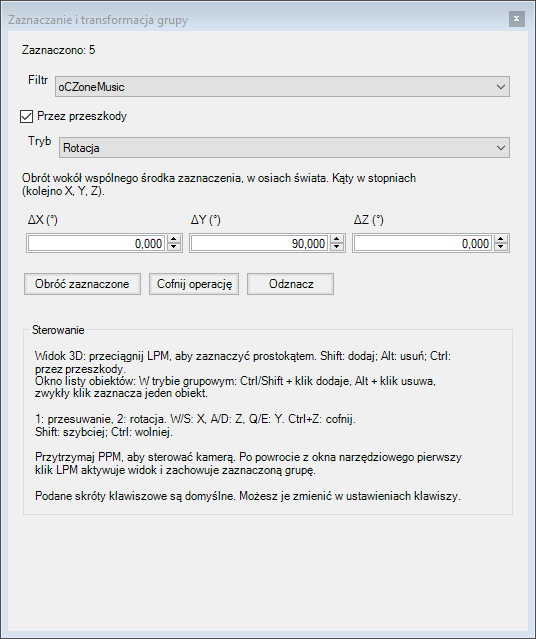
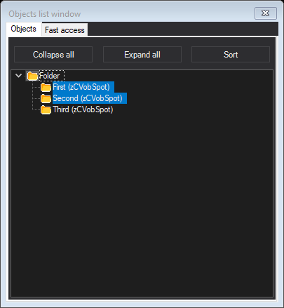

# Zaznaczanie i transformacja grupy

[English](GROUP_SELECTION.md) · [Kompilacja](../README.md#build-requirements) · [API backendu](https://github.com/Bezimienny111/SpacerNET_Union/blob/feature/group-selection/docs/GROUP_SELECTION_API.md)

## Instalacja i otwieranie

Podmień razem `SpacerUnionInterface.dll` i `SpacerUnionNet.dll` pochodzące z tej funkcji.
Interfejs zachowuje .NET Framework 4.0, a backend — x86, v140_xp i Union SDK 1.0l.
Nadal potrzebne są Gothic, Union i pozostałe pliki uruchomieniowe Spacer.NET.

Wczytaj świat i włącz **Multi selection mode** na głównym pasku narzędzi.
Otworzy się osobne okno **Zaznaczanie i transformacja grupy**, które nie zmniejsza widoku 3D.
Okno obsługuje motyw edytora, ukrywanie okien narzędziowych i zmianę języka. Zamknięcie go wyłącza tryb grupowy.
Sekcja **Sterowanie** pokazuje obsługę myszy i skróty właściwe dla bieżącego trybu transformacji.

Podgląd z automatycznego testu interfejsu; dane są przykładowe.

## Zaznaczanie w widoku 3D

| Sterowanie | Działanie |
| --- | --- |
| Przeciągnięcie LPM | Zastępuje grupę obiektami, których początki mieszczą się w prostokącie |
| Shift + przeciągnięcie | Dodaje obiekty |
| Alt + przeciągnięcie | Usuwa obiekty z grupy |
| Ctrl + przeciągnięcie | Uwzględnia obiekty zasłonięte geometrią świata |
| Przez przeszkody | Włącza ten sam wybór bez przytrzymywania Ctrl |
| Klik bez prostokąta | Zachowuje grupę |
| Pusty prostokąt bez modyfikatorów | Czyści zaznaczenie |

Pierwszy gest LPM po powrocie z okna narzędziowego aktywuje widok i zachowuje grupę aż do puszczenia przycisku.
Kolejne przeciągnięcie zaznacza normalnie. Powrót za pomocą PPM nie zabiera następnego gestu LPM.
DX7 i DX11 używają wspólnego algorytmu. Przeszkodami są tutaj statyczne wielokąty świata, a nie modele innych VOB-ów.

## Zaznaczanie w liście obiektów

Funkcja działa w **Objects list window**, w zakładkach **Objects** i **Fast access**.
Osobne okno wyszukiwania **VOB List** zachowuje oryginalne działanie.

| Klik na nazwie lub ikonie obiektu | Działanie |
| --- | --- |
| Ctrl + LPM albo Shift + LPM | Dodaje obiekt; ponowny klik nie tworzy duplikatu |
| Alt + LPM | Usuwa tylko wskazany obiekt |
| Sam LPM | Zastępuje grupę wskazanym obiektem |
| Dwuklik bez modyfikatorów | Wybiera obiekt i przybliża do niego kamerę |
| Klik folderu lub przycisku rozwijania | Nawiguje po drzewie i zachowuje grupę |

Podgląd z testu; dwa przykładowe wiersze należą do tej samej grupy.

Podświetlenie obu zakładek odpowiada zaznaczeniu w świecie. Sortowanie i przebudowa drzewa zachowują wybór według adresów obiektów.
Obowiązuje bieżący filtr grupy. Próba dodania obiektu odrzuconego przez filtr nie kasuje dotychczasowej grupy.
Wybór z drzewa nie zależy od położenia kamery ani przeszkód. W trybie gry edycja jest zablokowana.

## Filtry

Grupa oferuje **22 filtry**: wszystko; bez moverów i ich potomków; bez WP/freepointów; tylko itemy;
VOB-y bez itemów i moverów; WP + freepointy; same WP; same freepointy; oCMOB; kolizja dynamiczna;
oCMobInter; światła; dźwięki; bez PFX; niewidoczne; bez decali; bez decali i PFX; same decale;
same PFX; zCTrigger; zCZone; oCZoneMusic.

Filtr VOB-ów obejmuje także specjalizowane klasy VOB, z wyjątkiem itemów i moverów.
Niewidoczne oznacza brak visuala lub wyłączone `showVisual`.
oCMobInter i zCTrigger są osobnymi kategoriami. Filtr bez moverów wyklucza również całe ich poddrzewa.
Zmiana filtra od razu usuwa niepasujące obiekty z grupy.

Każdy filtr pomija kamerę widoku, obiekty pomocnicze edytora, obiekty niearchiwizowane, geometrię kompozycji poziomu i obiekty z innego świata.
[Pełna tabela identyfikatorów 0–21](GROUP_SELECTION.md#group-filters) jest częścią kontraktu API grupy, nie list legacy VOB List.

## Przesuwanie i obrót

Wybierz tryb **Przesuwanie** lub **Rotacja**, wpisz wartości X/Y/Z i użyj odpowiedniego przycisku.
Przesuwanie stosuje jednakowe przesunięcie w osiach świata, w jednostkach silnika.
Obrót stosuje kąty w stopniach kolejno wokół osi świata X, Y i Z.
Środek obrotu to średnia pozycji początków zaznaczonych obiektów, a nie środek ich bounding boxa.

| Skrót domyślny w widoku 3D | Przesuwanie | Rotacja |
| --- | --- | --- |
| 1 / 2 | Przełączenie na przesuwanie / obrót | Przełączenie na przesuwanie / obrót |
| W / S | Przód / tył względem poziomego kierunku kamery | Obrót wokół X |
| A / D | Lewo / prawo względem poziomego kierunku kamery | Obrót wokół Z |
| Spacja / X | Góra / dół | — |
| Q / E | — | Obrót wokół Y |
| Shift | 10 razy szybciej | 3 razy szybciej |
| Ctrl | 10 razy wolniej | 10 razy wolniej |
| Przytrzymany PPM | Sterowanie kamerą | Sterowanie kamerą |
| Ctrl+Z | Cofnięcie transformacji grupy | Cofnięcie transformacji grupy |

Skróty klawiatury można zmienić w istniejących ustawieniach edytora.
Dozwolone przesunięcie wynosi ±1 000 000 na oś, a kąt — ±3 600 stopni na oś w jednej operacji. Wartości muszą być skończone.
Zmiana trybu zeruje pola liczbowe; zmiana języka zachowuje tryb i wpisane wartości.

## Hierarchie, movery i cofanie

Obiekt zaznaczony razem z rodzicem jest transformowany tylko raz.
Niezaznaczeni potomkowie zachowują swoje pozycje i orientacje w świecie.
Klatki movera zaznaczonego do przesuwania lub obrotu podążają za grupą; trasy niezaznaczonych moverów pozostają na miejscu.
Odświeżane są pozycje sieci waypointów, splajny kamer i granice PFX.
Istniejąca blokada przesuwania obiektów z dziećmi obowiązuje dla całej operacji.

Przycisk **Cofnij operację** i Ctrl+Z przywracają pozycje, orientacje oraz klatki moverów.
Jedno ciągłe przytrzymanie klawiszy tworzy jedną operację; każde zatwierdzenie liczb — osobną.
Historia przechowuje do 32 transformacji grupy. Przycisk **Odznacz** zachowuje prawidłową historię.
Wyjście z trybu grupowego, usunięcie obiektu i reset świata ją unieważniają.
Cofanie jest odrzucane po zmianie świata, hierarchii lub liczby klatek movera.
Nie jest to ogólne cofanie usuwania obiektów ani zmiany rodzica.

Dotychczasowa zmiana rodzica nadal jest dostępna: Ctrl+X przygotowuje wybranego globalnego rodzica, a Ctrl+V stosuje go do grupy.

Oba ustawienia kontrolera korzystają z tej samej implementacji transformacji grupy.
Przeciąganie zewnętrznego gizma dla grupy nie jest zaimplementowane.

## Gdy coś nie działa

- Sprawdź tryb multi, filtr i to, czy edytor nie jest w trybie gry.
- Przy odrzuceniu ruchu hierarchii sprawdź opcję blokującą przesuwanie obiektów z dziećmi.
- Po zmianie świata/hierarchii ponownie zaznacz obiekty; stare migawki cofania są odrzucane.
- Przy błędzie brakującej funkcji DLL sprawdź, czy podmienione są obie biblioteki z tej samej wersji funkcji.

[Wyniki testów i lista prób w grze](https://github.com/Bezimienny111/SpacerNET_Union/blob/feature/group-selection/docs/VALIDATION.md) rozróżniają weryfikację automatyczną i uruchomienie na rzeczywistym silniku.
